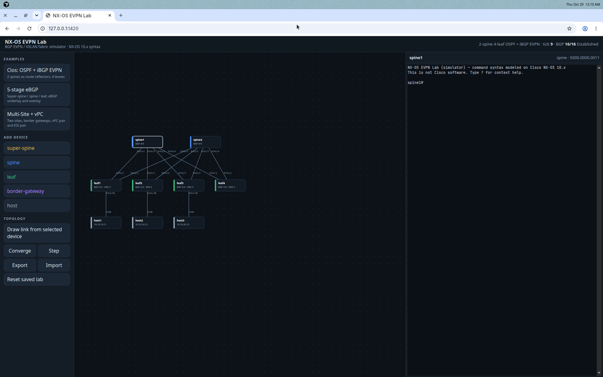
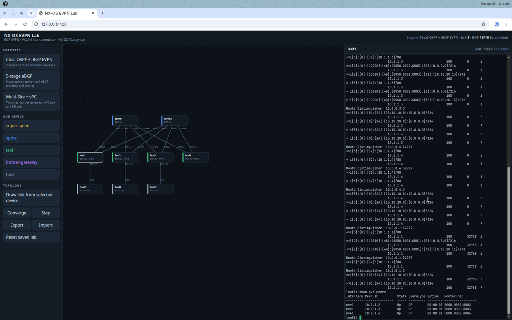

# NX-OS EVPN Lab

A browser and desktop simulator for designing and learning Cisco NX-OS BGP EVPN / VXLAN fabrics. Super-spine, spine, leaf, border-gateway, and host tiers share a real (simplified) control plane: interface state, OSPF, BGP, EVPN route types 1–5, VXLAN NVE peers, vPC, ESI designated-forwarder election, and EVPN Multi-Site re-origination.

Show commands are rendered from that computed state. The syntax and the fields they print follow Cisco Nexus 9000 NX-OS 10.x configuration guides and command references. Citations are in [docs/REFERENCES.md](docs/REFERENCES.md).

This is not Cisco software and it does not boot NX-OS.

## Run it in a browser

```bash
npm install
npm run dev
```

Open http://localhost:1420. `npm run dev` serves the Vite app. `npm run build` writes a static bundle to `dist/`, and `npm run preview` serves that bundle. No backend is required.

The lab is stored in `localStorage`. **Export** downloads `nxos-evpn-saved-labs.json` (the current lab and the backup). **Import** loads that file, or an older single-lab export. **Reset saved lab** clears the browser copy and reloads the clos example. A save from v0.1.x is migrated in place and the previous bytes are kept in a backup key. See [docs/UPGRADING.md](docs/UPGRADING.md).

## Desktop packages

Packaging uses [Tauri](https://v2.tauri.app/) v2. The UI is the same static bundle; the shell is small and does not add a simulation backend.

- Windows: the NSIS installer (`.exe`) from a GitHub Release. Run the installer and launch **NX-OS EVPN Lab**.
- Debian / Ubuntu: the `.deb` from the same release.
- Android: the universal APK from the same release. It installs on Android 7.0 (API 24) and newer. See [docs/ANDROID.md](docs/ANDROID.md) for the private signing key and the one-time uninstall.

```bash
sudo dpkg -i nxos-evpn-lab_0.1.0_amd64.deb
# or
sudo apt install ./nxos-evpn-lab_0.1.0_amd64.deb
```

The package depends on `libwebkit2gtk-4.1-0` and `libgtk-3-0`. The installed command is `nxos-evpn-sim`. A desktop build needs Rust 1.85 or newer (Tauri 2.7 uses Rust edition 2024). GitHub Actions installs the stable toolchain.

Build locally:

```bash
npm run tauri build -- --bundles deb     # Linux
npm run tauri build -- --bundles nsis    # Windows
```

GitHub Actions (`.github/workflows/ci.yml`) runs the unit tests, builds the web bundle, and builds the `.deb` on every pull request.

How each package upgrades, and which Actions secrets the Windows updater and Android signing need, is in [docs/UPGRADING.md](docs/UPGRADING.md). [SECURITY.md](SECURITY.md) covers the update check, the CSP, and dependency audits.

Every merge to `main` publishes a GitHub Release. The first one is `v0.1.0` (the version already in the repo). Each later merge bumps the patch (`v0.1.1`, `v0.1.2`, …) and writes that version back to `package.json`, `package-lock.json`, `src-tauri/tauri.conf.json`, `src-tauri/Cargo.toml`, and `src-tauri/Cargo.lock`. The release attaches the Windows NSIS `.exe`, the Debian `.deb`, the Android APK, and `nxos-evpn-lab-web.zip`. Pull requests from `cursor/*` are squash-merged by `.github/workflows/automerge.yml` after CI succeeds, and that same workflow calls the release workflow directly. A merge made with the Actions token does not emit a `push` event, so waiting for a tag or a main push would never start the release. Pushing a `v*` tag yourself still builds that exact version.

## Example fabrics

| Lab | What it is |
| --- | --- |
| Clos: OSPF + iBGP EVPN | 2 spines as route reflectors, 4 leaves, OSPF point-to-point underlay, iBGP L2VPN EVPN |
| 5-stage eBGP | 2 super-spines, 2 spines, 4 leaves. eBGP IPv4 underlay and eBGP EVPN overlay, leaves sharing an ASN, `allowas-in`, `disable-peer-as-check`, `retain route-target all`, next-hop unchanged |
| Multi-Site + vPC | Two sites, border gateways, a vPC leaf pair (anycast VTEP), and an ESI all-active pair |

After you load a fabric, BGP sessions should be **Established** and `show nve peers` should show **Up**. Hosts in the same L2VNI ping at layer 2. Hosts in different subnets of VRF `TENANT` ping through symmetric IRB.

## Using the CLI

Select a device. The terminal is an NX-OS-style shell (`leaf1#`, `leaf1(config-if)#`, …) with abbreviated commands, `?`, Tab, `no` forms, and pipes (`include`, `exclude`, `begin`, `section`, `count`).

Hosts are not switches. Their prompt accepts `ping`, `show ip`, and `show arp`.

A configuration change is applied immediately and the control plane is stepped until it settles (or 24 ticks pass), so `shutdown` and `remote-as` show up in the next show command.

### Supported commands

Exec and configuration modes:

- `show ip interface brief [vrf <name>|all]`
- `show interface [<iface>]`
- `show ip route [vrf <name>] [<prefix>]`
- `show ip ospf neighbors`
- `show bgp summary`
- `show bgp ipv4 unicast [summary]`
- `show bgp l2vpn evpn [summary] [route-type <1-5>]`
- `show nve peers` / `show nve vni` / `show nve interface` / `show nve ethernet-segment`
- `show l2route evpn mac all`
- `show l2route evpn mac-ip all`
- `show l2route evpn ethernet-segment all`
- `show mac address-table`
- `show vpc` / `show vpc brief`
- `show vlan` / `show vrf`
- `show lldp neighbors` / `show cdp neighbors`
- `show running-config` / `show startup-config`
- `ping <ip> [vrf <name>] [count <n>] [source <ip>]`
- `copy running-config startup-config` and `copy run start`
- `configure terminal`

Global configuration:

- `hostname`, `feature` / `no feature` for `bgp`, `ospf`, `nv overlay`, `vn-segment-vlan-based`, `interface-vlan`, `fabric forwarding`, `vpc`, `lacp`, `lldp`, `cdp`
- `nv overlay evpn`
- `fabric forwarding anycast-gateway-mac <mac>`
- `evpn multisite border-gateway <site-id>`
- `vlan`, `vn-segment`, `vrf context`, `vni`, `rd`, `route-target {import|export|both} {auto|<rt>} [evpn]`
- `interface Ethernet1/1` (also `loopback`, `Vlan`, `port-channel`, `nve`)
- `router bgp <asn>`, `router ospf <tag>`, `evpn`, `vpc domain <id>`, `route-map <name> permit <seq>`

Interface: `shutdown` / `no shutdown`, `switchport` / `no switchport`, `switchport mode access|trunk`, `switchport access vlan`, `ip address <cidr>` / `secondary` / `tag`, `vrf member`, `ip router ospf <tag> area <area>`, `ip ospf network point-to-point`, `fabric forwarding mode anycast-gateway`, `ip forward`, `vpc peer-link`, `vpc <id>`, `evpn multisite dci-tracking`, `evpn multisite fabric-tracking`, `ethernet-segment` / `esi`.

NVE: `source-interface`, `host-reachability protocol bgp`, `member vni <id>`, `ingress-replication protocol bgp`, `mcast-group`, `associate-vrf`, `multisite border-gateway interface`.

BGP: `router-id`, `address-family ipv4 unicast`, `address-family l2vpn evpn`, `neighbor`, `remote-as`, `update-source`, `ebgp-multihop`, `peer-type fabric-external`, `send-community extended|both|standard`, `route-reflector-client`, `allowas-in`, `disable-peer-as-check`, `rewrite-evpn-rt-asn`, `route-map … in|out`, `retain route-target all`, `maximum-paths`, `maximum-paths ibgp`, `redistribute direct`, `network`, `nexthop route-map`.

vPC domain: `peer-keepalive destination <ip> [source <ip>]`, `role priority`, `peer-gateway`.

Route-map: `match interface`, `match tag`, `set ip next-hop unchanged`.

`rd auto` follows the NX-OS rule from the VXLAN configuration guide: IP-VRF uses `router-id:(VRF ID)` with user VRFs starting at 3, and MAC-VRF uses `router-id:(VLAN + 32767)`. `route-target auto` is `ASN:VNI`, or `23456:VNI` when the ASN is 4 bytes.

Feature gating matches the guides: `router bgp` without `feature bgp` prints `BGP feature is not enabled`. An unknown keyword prints `% Invalid command at '^' marker.`

## Tests

```bash
npm test
```

Vitest covers OSPF adjacency and a shutdown failure, BGP session establishment and an AS mismatch, EVPN type-2/3/5 through route reflectors and through the eBGP super-spine fabric, NVE peer discovery, the anycast-gateway MAC, vPC role, ESI modulus DF election, Multi-Site re-origination, and CLI parsing for the main show commands.

## Known limitations versus NX-OS

These are intentional simplifications. They are not claimed as NX-OS behavior.

- **No data-plane chip and no real TCP.** BGP and OSPF advance one FSM state per tick when the configuration and the RIB allow it. There is no TCP port 179, no Connect/Active timer oscillation, no BFD, and no authentication.
- **OSPF** is single-area flooding of router LSAs, point-to-point or a two-router broadcast DR/BDR. No stub/NSSA areas, virtual links, or external LSAs. Link cost is 1.
- **BGP** best path is weight, local preference, AS-path length, origin, MED, eBGP over iBGP, then neighbor address. `maximum-paths` is eBGP; `maximum-paths ibgp` is iBGP. No add-paths, graceful restart, or dynamic capability exchange. `ebgp-multihop` is checked against the RIB hop count (minimum 2 when the peer is not on a connected subnet).
- **EVPN** generates types 1, 2, 3, 4, and 5. Import uses route targets. Spines keep routes only when `retain route-target all` is set, which is what the configuration guide requires for eBGP spines and what iBGP route-reflector spines need when they have no local VRFs. There is no ARP-suppression cache, no TRM, and no multicast forwarding. `mcast-group` is stored and shown; BUM learning in this lab still comes from BGP (type 3) when ingress replication is configured.
- **`rewrite-evpn-rt-asn`** rewrites the incoming route-target ASN to the **local** ASN so `route-target import auto` matches across sites. The NX-OS 10.5 guide text also says the rewrite matches “the BGP-configured neighbor’s remote AS number,” which would not change an auto-RT that already carries that peer ASN. The local-ASN behavior is what makes the published auto-RT Multi-Site design work. See [docs/REFERENCES.md](docs/REFERENCES.md).
- **Symmetric IRB** installs type-2 MAC-IP /32 host routes (`hmm`) and type-5 prefixes. Every leaf that has the anycast SVI also originates the subnet as a type-5, which is what NX-OS does; forwarding to a specific host uses the longer /32.
- **vPC** models the domain, peer-link, peer-keepalive reachability, role priority, member-port suspension when the peer-link is down, and the anycast VTEP secondary IP. `show vpc` includes the real header fields. Delay-restore, auto-recovery, and type-2 consistency checks are printed at their documented defaults and are not simulated.
- **ESI** DF election is the RFC 7432 modulus over VTEP addresses learned from type-4 routes, using the access VLAN as the Ethernet tag. Unicast to a dual-homed host can be delivered by either VTEP. There is no per-flow DF hashing.
- **Multi-Site** re-originates best fabric routes out the DCI with the border-gateway VIP as next hop and secondary RD `site-id:VNI` (when the site id fits in two bytes), and re-originates DCI routes back into the fabric with the BGW VTEP as next hop. Re-origination stops when every DCI-tracking or fabric-tracking interface is down. Storm control, backup SVI, and delay-restore are not simulated.
- **Counters.** `show interface` prints the administrative and operational fields from the NX-OS header (state, MAC, IP, MTU, mode). Packet counters are not simulated, so they are omitted rather than filled with invented traffic. `show bgp summary` memory figures are a fixed formula (`paths * 96`), not allocator output. L2RIB local next hops use a stable simulated ifindex.
- **Not implemented:** IPv6, PIM, IGMP, DHCP, AAA, ACLs, QoS, SPAN, TCAM carving, `show version` (it would require inventing a chassis), multiple NVE interfaces, and route-map match clauses other than interface and tag.

## Screenshots

Topology and CLI after the clos fabric converges:



`show bgp l2vpn evpn` and `show nve peers` on a leaf:


